# 차곡차곡 (Chagok Chagok)

> 코드 이름 AutoTrip (패키지 `com.autotrip`)
>
> 차량이 운행을 기록하고, 운전자는 내비에 목적지를 찍을 때 음성으로 목적만 답하면 국세청 고시 「업무용승용차 운행기록부」 서식 양식에 맞춘 PDF가 만들어지는 Pleos Connect 차량용 앱

| 대기 중 | 거래처 제안 (출발 시) | 운행기록부 PDF |
|---|---|---|
| 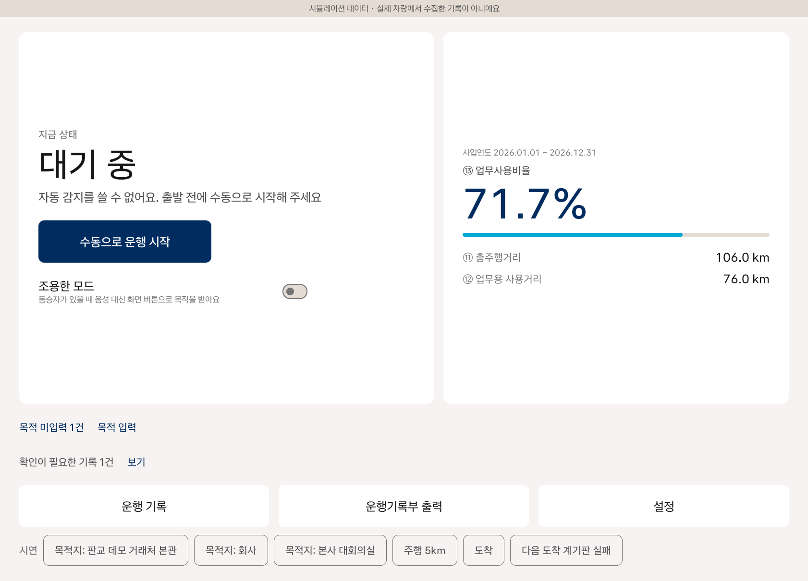 | 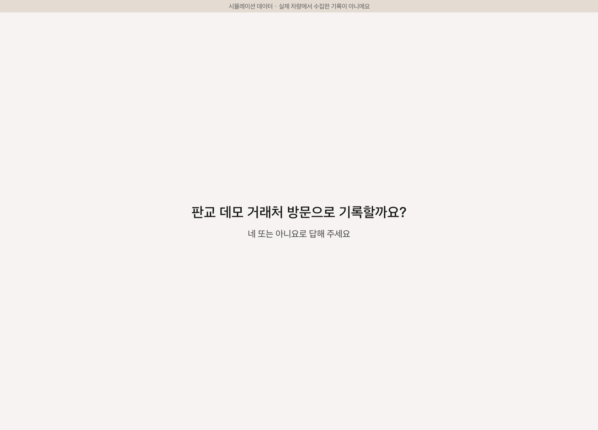 | 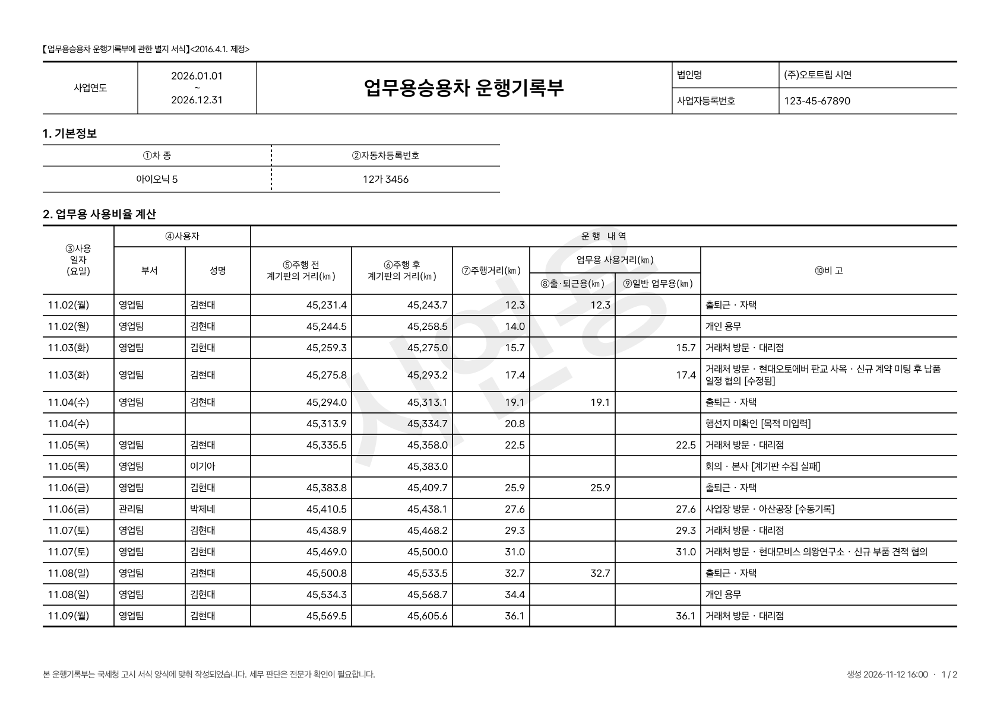 |

## 주요 기능

| 기능 | 설명 |
|---|---|
| 운행 기록 | 차량 계기판 누적거리(Odometer)로 출발·도착 시점의 거리를 기록합니다. 실제 차량 모드에서는 차량 속도로 출발을 감지해 운행을 자동으로 시작하고(5km/h 이상 3초 유지 시), 종료는 홈 화면에서 직접 누릅니다. 수동 시작도 지원합니다. |
| 출발·도착 위치 | 기기 GPS로 출발·도착 위치를 저장합니다. 장소 이름이 없으면 좌표를 보여 주고, 위치를 받지 못하면 "-"로 둡니다. |
| 출발 시 음성 목적 입력 | 내비에 목적지를 설정하면 TTS로 "이번 운행 목적은 무엇인가요?"라고 묻고, STT로 답을 받아 7가지 목적(거래처 방문, 현장 방문, 회의, 판촉, 교육, 출퇴근, 사적 사용)으로 분류합니다. 마이크가 준비되는 동안은 "잠시만요", 준비되면 "듣고 있어요"를 표시합니다. 인식하지 못하면 한 번 더 묻고, 그래도 안 되면 정차 중에 버튼으로 고릅니다. |
| 이전 목적·거래처 제안 | 전에 같은 목적지로 간 적이 있으면 "지난번처럼 회의로 기록할까요?", 등록한 거래처이면 "○○ 방문으로 기록할까요?"라고 먼저 묻고, "네"라고 답할 때만 그 목적으로 기록합니다. |
| 도착 안내 | 도착하면 다시 묻지 않고 "○○으로 기록했어요"라고 결과만 알려 줍니다. |
| 조용한 모드 | 동승자가 있을 때 홈 화면 스위치로 켭니다. 음성 질문·안내 없이 정차 중 화면 버튼으로 목적을 받습니다. 고르지 않고 출발한 운행은 '목적 미입력'으로 남습니다. |
| 목적 미입력 안내 | 내비 없이 출발한 운행은 '목적 미입력'으로 남고, 정차 중에 목록에서 입력합니다. |
| 기록 목록·수정 이력 | 목적, 차량이용자, 메모만 수정할 수 있고 모든 수정은 이력으로 남습니다. 계기판 거리·시각·위치는 수정할 수 없고, 기록은 삭제할 수 없습니다. |
| 확인이 필요한 기록 | 목적 미입력, 업무 목적인데 행선지 없음, 앞뒤 운행의 계기판 거리 불연속, 운행 7일 뒤 목적 입력, 계기판 미지원·수집 실패 기록을 골라 사유를 보여 줍니다. 기록이 맞는지 판정하지는 않습니다. |
| 운행기록부 PDF | 과세기간(사업연도)을 선택하면 국세청 고시 서식 배치대로 ①~⑬ 항목과 업무사용비율을 출력합니다. 목적 미입력·계기판 수집 실패 운행이 있으면 출력 전에 알리고 PDF 하단에 건수를 적습니다. 만든 PDF는 앱 안에서 쪽 단위로 미리 볼 수 있습니다. |
| 주행 중 UI 제한 | 주행 중에는 입력 요소·목록·수정 화면을 숨기고 큰 글씨의 상태 표시와 음성만 사용합니다. |
| 권한 안내 | 처음 실행할 때 필요한 권한(마이크, 차량 속도, 위치)을 정차 중에 한 번 요청합니다. 설정 화면의 권한 카드에서 상태를 보고 다시 허용할 수 있습니다. 거부해도 버튼 입력·수동 운행으로 계속 사용할 수 있습니다. |

### 구현 범위

- **시연 모드(Debug 빌드)**: 차량 대신 모의 데이터로 운행·목적지 설정·도착을 재현합니다. 화면 상단에 "시뮬레이션 데이터" 배너가, PDF에 "시연용" 워터마크가 들어갑니다. 음성(TTS·STT)은 실제 Pleos SDK를 사용합니다.
- **실제 차량 모드(Release 빌드)**: 차량 속도(`CarPropertyManager`)·계기판(Pleos Vehicle SDK)·내비 이벤트와 기기 GPS를 사용합니다.

**실제 차량 모드 검증 결과** (Pleos Connect Emulator 2.1.0, Virtual Console로 기어·속도 입력)

| 항목 | 결과 |
|---|---|
| Virtual Console 차량 속도 → 앱 수신 | 확인 (35km/h 입력 시 차량 속도 값 변화와 앱 상태 전환) |
| 차량 속도로 운행 자동 시작 | 확인 (수동 조작 없이 '주행 중' 전환, 기록 방식 '자동') |
| 운행 종료(수동) · 기록 저장 · 목록·상세 조회 | 확인 |
| 앱·에뮬레이터 재실행 후 운행 상태 복원 | 확인 (주행 중 운행과 종료된 운행 모두) |
| 계기판 누적거리 조회 (출발·도착) | 확인 (SDK 응답 정상) |
| 운행기록부 PDF 생성 · 앱 안 저장 · 미리보기 | 확인 |
| 첫 실행 시스템 권한 창 승인·거부 | 미검증 (에뮬레이터에서 권한 창이 화면에 표시되지 않는 문제) |
| 내비 목적지 → 음성 목적 입력 | 미검증 (시연 모드에서는 확인) |
| 실제 이동에 따른 GPS 위치·거리 증가 | 미검증 (Virtual Console 입력으로는 계기판 거리가 늘지 않음) |
| PDF 외부 저장·공유 | 미검증 |

검증 중 에뮬레이터가 한 번 비정상 종료된 뒤 다시 실행해 이어서 확인했습니다. 차량 SDK의 첫 연결이 느려지는 현상(과거 측정 약 12초)은 이번 검증에서는 나타나지 않았지만 해결을 확인한 것은 아닙니다.

- 운행 자동 종료는 아직 지원하지 않습니다. 운행 종료는 홈 화면에서 직접 누릅니다.
- 앱이 실행 중일 때만 운행을 감지합니다. (백그라운드 서비스·부팅 자동 실행 없음)

## 화면

| | | |
|---|---|---|
| <br>대기 중 (홈) | 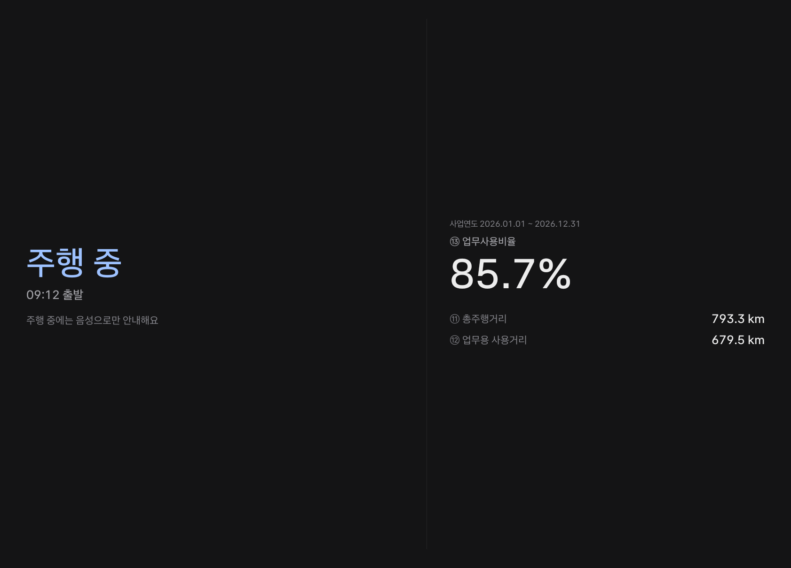<br>주행 중 (입력 요소 숨김) | <br>거래처 제안 |
| 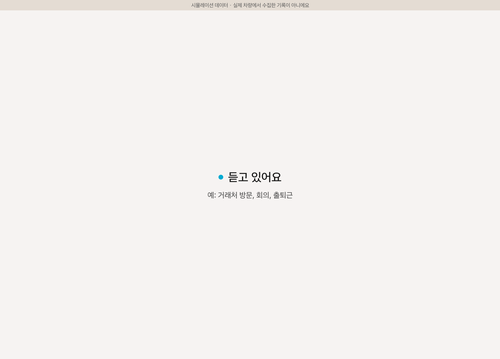<br>음성 인식 중 | 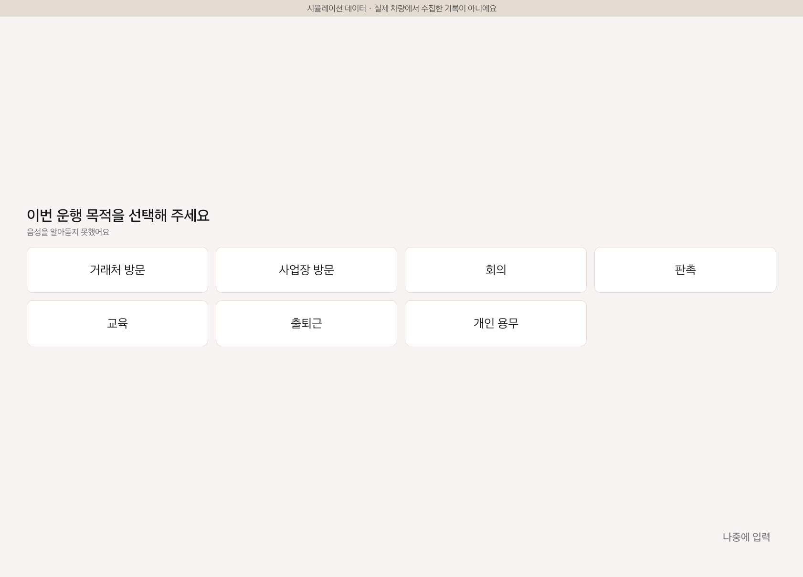<br>정차 중 버튼 선택 | 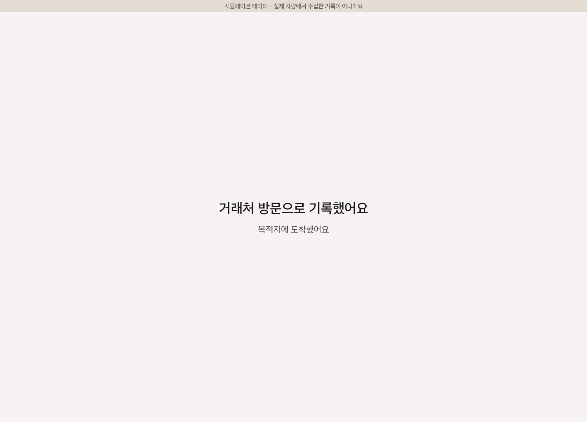<br>도착 안내 |
| 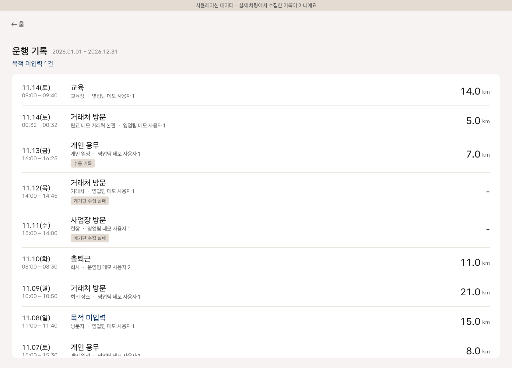<br>운행 기록 | 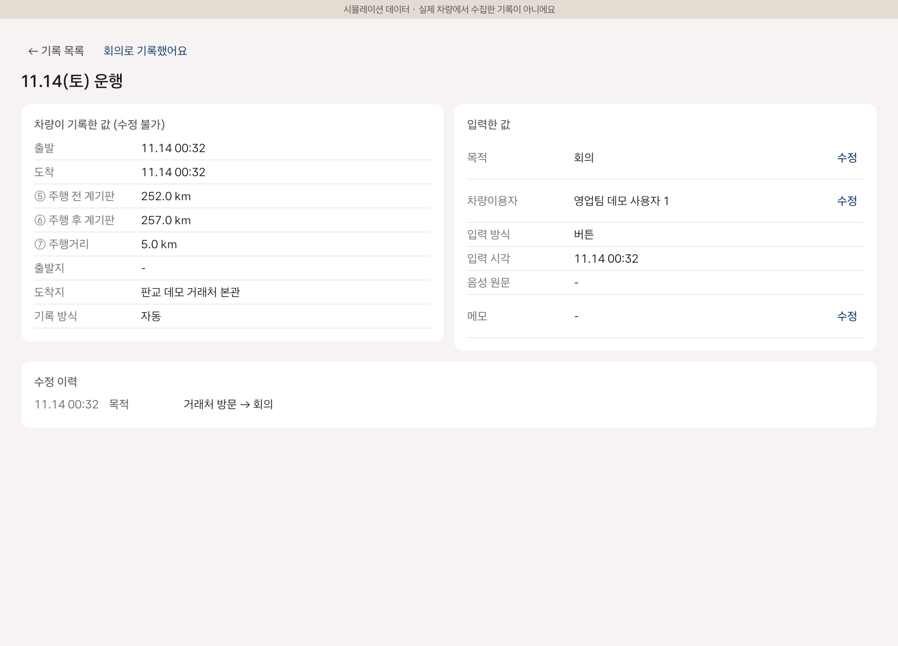<br>상세·수정 이력 | 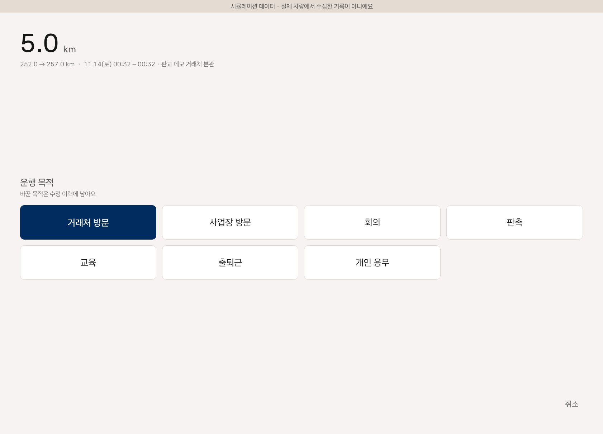<br>목적 수정 |
| 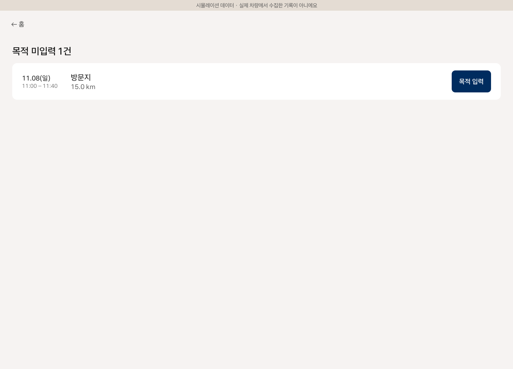<br>목적 미입력 | 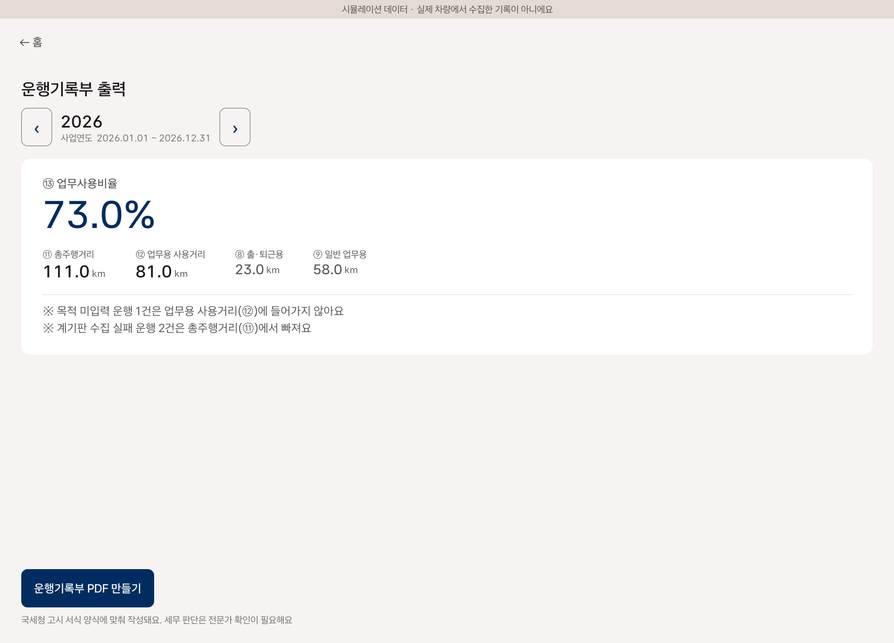<br>운행기록부 출력 | 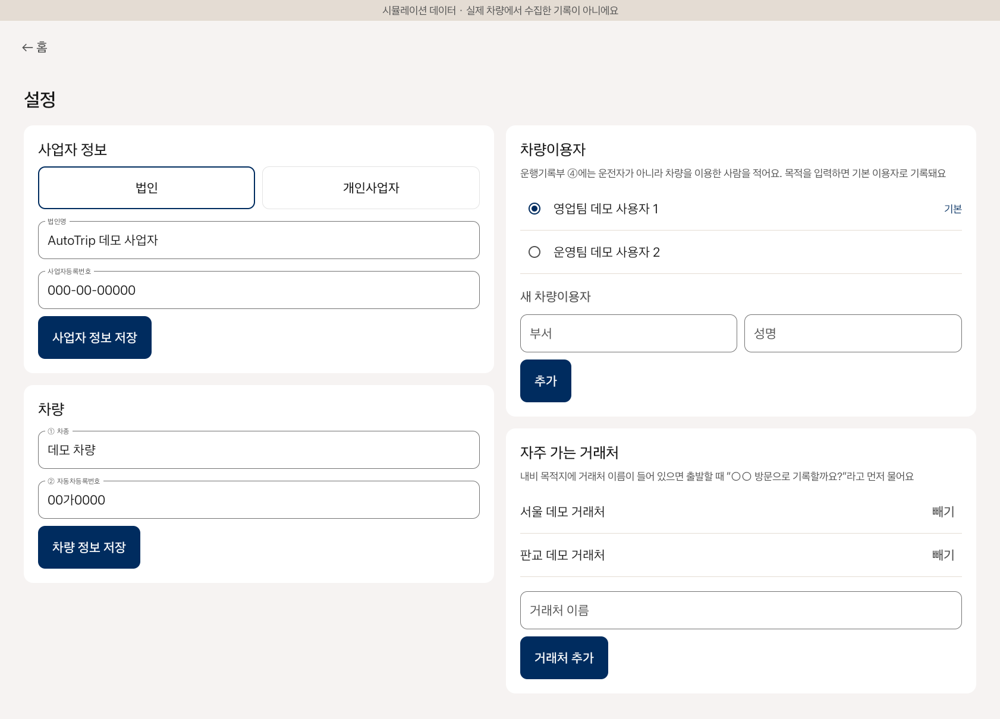<br>설정 (사업자·차량·이용자·거래처) |
| 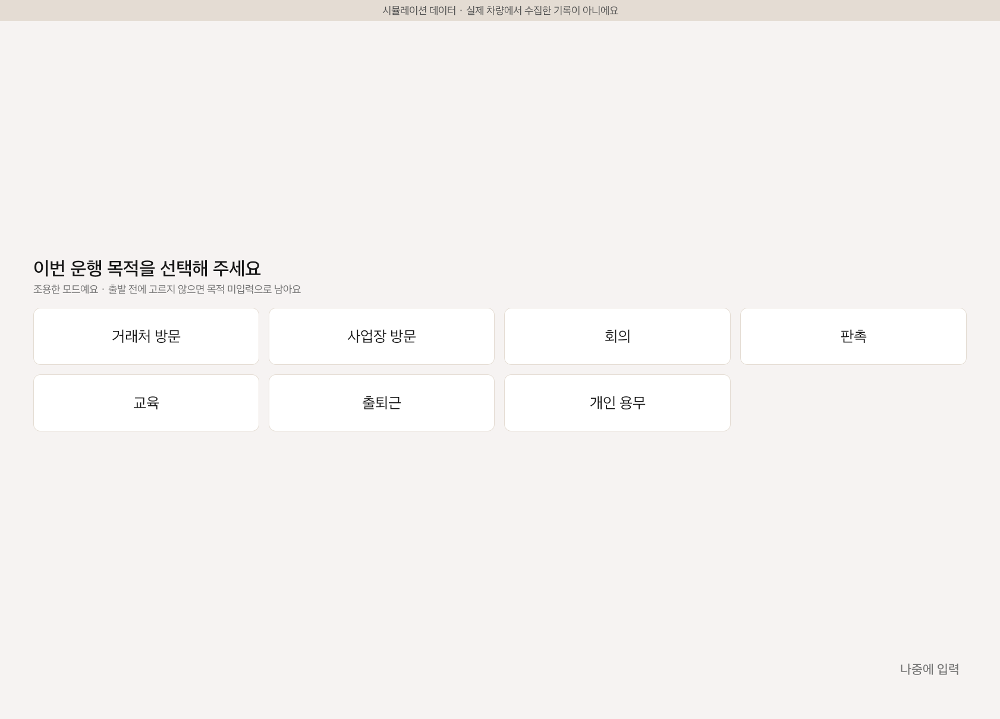<br>조용한 모드 (소리 없이 버튼) | | |

PDF 예시: [docs/sample_logbook.pdf](docs/sample_logbook.pdf) (시연용 워터마크 포함)

## 사용한 SDK

| SDK | 버전 | 용도 |
|---|---|---|
| Pleos Vehicle (Odometer, CarInfo) | 2.3.2 | 계기판 누적거리(서식 ⑤⑥⑦), 차종 |
| Pleos NaviHelper | 3.0.5 | 목적지 설정 시점(목적 질문), 목적지 이름(거래처 제안·⑩ 비고) |
| Pleos TextToSpeech | 3.3.1 | 목적 질문, 거래처 제안, 확인·도착 안내 (온디바이스 모드, 한국어) |
| Pleos SpeechToText | 3.3.1 | 운행 목적·"네/아니요" 음성 인식 (온디바이스 모드, 한국어) |

Android 표준 API: `CarPropertyManager`(차량 속도), `LocationManager`(GPS 위치), `CarUxRestrictionsManager`(주행 중 UI 제한), `PdfDocument`·`PdfRenderer`(PDF 출력·미리보기), Room(로컬 저장)

## 실행 방법

### 1. APK 설치

`apk/` 폴더에 두 가지 APK가 있습니다.

| 구분 | 파일 | 모드 | 설명 |
|---|---|---|---|
| **제출 APK** | [`apk/인하 CCC_차곡차곡_release.apk`](<apk/인하 CCC_차곡차곡_release.apk>) | 실제 차량 모드 (Release) | 차량 속도·계기판·내비 이벤트와 기기 GPS를 사용합니다. 테스트용 인증서로 서명되어 있습니다. 검증 범위는 위 "구현 범위"를 참고해 주세요. 주행은 아래 "주행 시뮬레이션"처럼 Virtual Console로 재현합니다. |
| 보조 시연 APK | [`apk/chagok_demo.apk`](apk/chagok_demo.apk) | 시연 모드 (Debug) | 모의 데이터로 운행 시작·목적지 설정·도착을 화면의 시연용 버튼으로 재현합니다. 음성은 실제 Pleos TTS·STT를 사용합니다. 시연 영상과 같은 흐름입니다. |

1. Pleos Connect Emulator 2.1.0을 실행합니다. (설정은 아래 "테스트 환경" 참고)
2. APK를 설치합니다.

   ```bash
   adb install -r "apk/인하 CCC_차곡차곡_release.apk"
   ```

   음성 목적 입력까지 한 번에 보려면 시연 APK(`adb install -r apk/chagok_demo.apk`)를 설치합니다.

3. 에뮬레이터의 앱 목록에서 **차곡차곡**을 실행합니다.

두 APK는 패키지 이름(`com.autotrip`)이 같고 서명이 달라서 함께 설치할 수 없습니다. 다른 쪽을 설치하려면 먼저 `adb uninstall com.autotrip`으로 삭제해 주세요.

| 파일 | SHA-256 |
|---|---|
| chagok_demo.apk | `c24d02c4d2fc739a63058efa62eaac37cbf4e175ef6feb3bf270e3b1c6013f3a` |
| 인하 CCC_차곡차곡_release.apk | `9955b1c864ab48458e8518b1fb79b2644fee69d655207ad8ba36d7ef56d717cf` |

### 2. 소스 빌드

1. 저장소를 clone하고 Android Studio에서 프로젝트 폴더를 엽니다.
2. **Gradle JDK를 17로 설정합니다.** (아래 "필요한 설정" 참고)
3. Gradle Sync가 끝나면 빌드하고 설치합니다.

   ```bash
   ./gradlew assembleDebug
   adb install -r app/build/outputs/apk/debug/app-debug.apk
   ```

   Debug 빌드는 시연 모드입니다. 실제 차량 모드는 `assembleRelease`로 빌드하며, 서명 설정은 저장소에 포함하지 않습니다.

### 3. 시연 모드 흐름

1. 홈의 시연용 버튼으로 주행을 시작합니다 → 주행 중 화면으로 바뀌고 입력 요소가 사라집니다.
2. 시연용 버튼으로 목적지를 설정하면 음성으로 목적을 묻습니다. "거래처 방문"처럼 답합니다.
3. 시연용 도착 버튼을 누르면 기록 결과를 안내합니다.
4. 운행 기록에서 확정된 운행을 보고, 운행기록부 출력에서 PDF를 만들고 미리 봅니다.

### 4. 주행 시뮬레이션 (Virtual Console, 실제 차량 모드)

```bash
adb forward tcp:8088 tcp:8088
```

1. 브라우저에서 http://127.0.0.1:8088 에 접속합니다. (페이지를 열어 둔 상태에서만 차량 입력이 적용됩니다)
2. 기어 **P**, 속도 **0km/h**로 5초 이상 둡니다.
3. 기어를 **D**로 바꾸고 속도를 **35km/h** 정도로 올려 3초 이상 유지합니다 → 홈 화면이 '주행 중'으로 바뀌고 운행이 자동으로 시작됩니다.
4. 속도를 0km/h, 기어를 P로 돌린 뒤 홈 화면의 **운행 종료**를 누릅니다.
5. 운행 기록에서 새 기록(기록 방식 '자동')을 확인하고, 운행기록부 출력에서 PDF를 만들어 미리 봅니다. (설정에 사업자·차량 정보가 있어야 합니다)

## 테스트 환경

| 항목 | 내용 |
|---|---|
| 에뮬레이터 | **Pleos Connect Emulator 2.1.0** (Android 14, API 34, Automotive) |
| 화면 규격 | **2560 × 1440, 160 dpi** |
| AVD 설정 | RAM 4 GB, Default boot: Cold |
| 개발 도구 | Android Studio, Gradle 8.2, Android Gradle Plugin 8.2.2, Kotlin 1.9.0 |
| 앱 설정 | minSdk 28, compileSdk 34 |
| 개발 PC | Windows 11 |

에뮬레이터 설치 방법은 [Pleos Connect 개발 환경 설정 가이드](https://document.pleos.ai/docs/connect/guide/getting-started/application-development/setup-connect-sdk-emulator)를 따릅니다.

## 필요한 설정

### Gradle JDK (소스 빌드 시 필수)

이 프로젝트는 **JDK 17**로 빌드합니다.

- JDK 21 이상에서는 Gradle Sync 또는 Room 코드 생성(kapt, Kotlin 1.9.0)이 실패합니다.
- Android Studio → **Settings → Build, Execution, Deployment → Build Tools → Gradle → Gradle JDK**에서 JDK 17(예: Android Studio에 들어 있는 jbr-17)을 선택합니다.
- 터미널에서 `./gradlew`로 빌드할 때는 `JAVA_HOME`을 JDK 17로 맞춥니다.
- APK만 설치해 실행할 때는 이 설정이 필요 없습니다.

### 앱 첫 실행

1. **권한을 허용합니다.** 마이크(음성 목적 입력), 차량 속도(운행 자동 시작), 위치(출발·도착지). 시연 모드는 마이크만 요청합니다.
2. **설정**에서 사업자 정보(법인·개인사업자, 상호명, 사업자등록번호), 차량(① 차종, ② 자동차등록번호), 차량이용자를 입력합니다. 사업자·차량 정보가 없으면 운행기록부를 출력할 수 없습니다.
3. (선택) **자주 가는 거래처**를 등록하면 그곳을 목적지로 찍을 때 "○○ 방문으로 기록할까요?"라고 먼저 묻습니다.
4. (선택) 동승자가 있을 때는 홈 화면의 **조용한 모드**를 켭니다.

### 에뮬레이터 설정

- **마이크**: 에뮬레이터 Extended controls → **Microphone → Enable Host Microphone Access**를 켜야 음성 인식이 동작합니다.
- **시간대**: 서울(GMT+9)이 아니면 운행 시각이 다르게 보입니다. 에뮬레이터 설정에서 시간대를 서울로 맞춥니다.
- **종료**: 프로세스를 강제로 종료하면 가상 기기의 데이터가 손상될 수 있습니다. 창을 닫거나 Android Studio의 Stop으로 종료합니다.

### 테스트

```bash
./gradlew testDebugUnitTest            # 목적 분류, 질문 흐름, 자동 시작 규칙, 화면 표시 규칙 등 단위 테스트
./gradlew connectedDebugAndroidTest    # 화면·PDF·주행 제한 확인 (에뮬레이터 필요)
```

## 문서

- [공통 데이터 모델·인터페이스 (INTERFACES.md)](docs/INTERFACES.md)
- [운행 자동 시작 통합 (AUTO_START_INTEGRATION.md)](docs/AUTO_START_INTEGRATION.md)
- [자동 시작 검증 절차 (PLEOS_AUTO_START_VALIDATION.md)](docs/PLEOS_AUTO_START_VALIDATION.md)
- [자동 종료 신호 조사 (AUTO_END_SIGNAL_RESEARCH.md)](docs/AUTO_END_SIGNAL_RESEARCH.md)

## 유의 사항

본 운행기록부는 국세청 고시 서식 양식에 맞춰 작성되었습니다. 세무 판단은 전문가 확인이 필요합니다.
